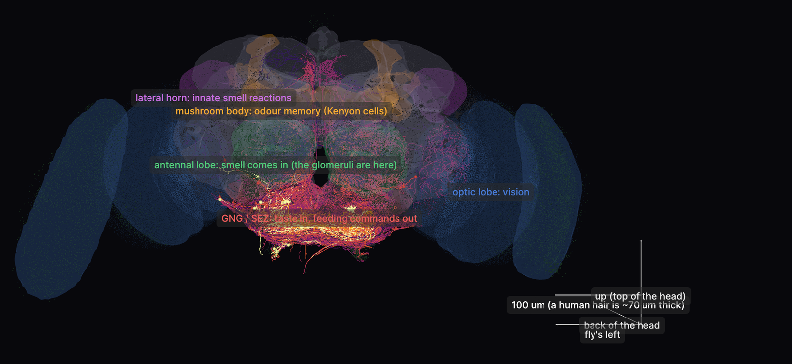

# flyevo

**Simulating a whole fruit-fly brain on a 4 GB gaming GPU — as the first step towards evolving one in silico.**



*All 138,639 neurons of an adult* Drosophila *brain. Sugar-sensing neurons are being stimulated; the
386 neurons that respond are drawn with their real shapes (from electron microscopy) and glow as
they fire. Activity enters the taste/feeding centre at the bottom and spreads upwards.
Rendering derived from FlyWire data, CC BY-NC 4.0 — see [Data & credits](#data--credits).*

> A spare-time project. I am a software engineer, not a neuroscientist; this repo is me learning
> computational neuroscience by building things, and writing down honestly what worked and what
> did not. It is work in progress.

## The question

The fruit fly *D. sechellia* split from its generalist relatives and specialised on a single toxic
fruit (noni). Recent comparative-connectomics papers measured what changed in its brain: not the
wiring diagram, but a handful of *parameters* — how many neurons carry a given smell channel, and
how strongly they connect to the memory centre.

So: **if you take a model of the generalist's smell circuit and put it under selection for the
specialist's niche, does simulated evolution turn the same knobs that real evolution did?** And if
it does, can the same procedure predict species whose brains have not been mapped yet?
The fitness is purely ecological; the real species data is never shown to the optimiser — it is
the held-out exam. Full plan (in Turkish): [docs/PLAN.md](docs/PLAN.md).

## What exists today

**1. A whole-brain spiking simulator in JAX** — [`src/flyevo/models/lif.py`](src/flyevo/models/lif.py)

A from-scratch GPU port of the leaky integrate-and-fire model of
[Shiu et al. 2024](https://doi.org/10.1038/s41586-024-07763-9) (originally Brian2, CPU).
138,639 neurons, 15.1 million connections.

- Event-driven spike propagation over a CSR edge list with static shapes (JIT-friendly), plus an
  exact dense fallback: the budgets only change speed, never a single spike (there is a test for that).
- ~23 s of wall time per simulated second on a GTX 1650; the first dense version needed ~150 s.
- Validated against the reference implementation's published results for the same experiment
  (activate sugar-sensing neurons, read out a feeding motor neuron):

  | | reference (Brian2) | this port |
  |---|---|---|
  | stimulated neurons | 99.0 Hz | 99.3 Hz |
  | active neurons | 404 | 406 |
  | feeding motor neuron MN9 | 67.0 Hz | 70.5 Hz |

  Per-neuron firing rates correlate at r = 0.95 over the neurons active in both. The two runs use
  different connectome releases (v630 vs v783), so an exact match is not expected; a same-data
  comparison is still on the to-do list.

**2. A 3D view of the brain at work** — [`src/flyevo/viz/`](src/flyevo/viz/)

[Rerun](https://rerun.io) recordings with labelled brain regions, a scale bar, and the real
branching shapes of the neurons that fire, coloured by firing rate on a scrubbable timeline.

**3. A negative result, kept on purpose** — [docs/M1_RESULT.md](docs/M1_RESULT.md) (Turkish)

Before spending months on evolution experiments, one go/no-go test with a decision rule written
down *before* the run: apply the measured *D. sechellia* changes
([Ellis et al. 2024](https://doi.org/10.1038/s41467-024-48839-4)) to the model brain by hand and
check that the memory centre (mushroom body) responds in the right direction.

**Verdict: no-go.** In this whole-brain model the mushroom body is saturated and cannot tell
odours apart: ~75 % of its Kenyon cells fire for *any* odour (a real fly: ~5–10 %), and they are
the same cells every time (overlap 0.998). The cause is visible in the connectivity itself —
Kenyon cells receive more input from each other than from the smell pathway, the model treats all
of it as plain excitation, and the single inhibitory "brake" neuron hits its firing-rate ceiling.
The simulator is fine (see the validation above); the model is simply too coarse for this
particular circuit. So the evolution experiments will run on a dedicated model of the smell
circuit instead, and the whole-brain simulator stays as a validated tool and a showcase.

## Roadmap

- [x] Whole-brain LIF simulator on the GPU, validated against the reference
- [x] 3D visualisation with real neuron morphologies
- [x] Go/no-go pre-test of the whole-brain model → **no-go**, documented
- [ ] Rate model of the smell circuit (antennal lobe → mushroom body → output neurons) with sparse coding
- [ ] Ecological fitness + evolution runs (CMA-ES, a neutral-drift null model, MAP-Elites)
- [ ] Compare against the measured *D. sechellia* changes, mechanism by mechanism
- [ ] Frozen, dated predictions for species without a connectome yet

## Try it

The tests and the visualisation run on a CPU; simulations want an NVIDIA GPU through Docker.

```bash
uv sync --extra dev          # Python 3.13 environment from the lockfile
uv run pytest                # 50 tests
uv run flyevo doctor         # what does the environment look like?
```

GPU (Docker Desktop + NVIDIA driver; data download described in [scripts/README.md](scripts/README.md)):

```bash
make docker
docker compose -f docker/compose.yaml run --rm --entrypoint "uv run --no-sync python -u" \
    flyevo scripts/flywire_experiment.py configs/pretest/sugar_grn.yaml
uv run python scripts/flywire_viz.py runs/pretest/sugar_grn     # → viz.rrd
uv run rerun runs/pretest/sugar_grn/viz.rrd
```

[`scripts/explore/`](scripts/explore/) is a numbered walk-through — what is in the data, what one
odour does to the model brain, why the mushroom body saturates, what a neuron actually looks like.

## Layout

```
src/flyevo/     the package
  models/       lif.py — the simulator (data-agnostic, pure JAX)
  viz/          Rerun logging and figures
  data/         small derived tables with their source DOI
  ...           circuit/ develop/ env/ fitness/ evo/ analysis/ — the evolution part, still empty
configs/        every experiment is a YAML; nothing is hard-coded
scripts/        everything that touches FlyWire data (CC BY-NC) lives here, outside the package
tests/          unit tests (simulator rules one by one, analytic checks, viz, loaders)
docker/         one GPU image: python-slim + jax[cuda12]
docs/           plan, milestone results
```

Stack: Python 3.13 · JAX · uv · Docker · Rerun · polars · pytest · ruff · mypy.

## Data & credits

No connectome data is stored in this repository; scripts download it from the original sources.

| What | Source | License |
|---|---|---|
| Code in this repo | — | Apache-2.0 |
| Whole-brain connectome (FlyWire v783) | Dorkenwald et al. 2024, [doi:10.1038/s41586-024-07558-y](https://doi.org/10.1038/s41586-024-07558-y) | CC BY-NC 4.0 |
| Neuron annotations, positions, skeletons | Schlegel et al. 2024, [doi:10.1038/s41586-024-07686-5](https://doi.org/10.1038/s41586-024-07686-5); [Zenodo 10877326](https://doi.org/10.5281/zenodo.10877326) | CC BY-NC 4.0 / CC BY 4.0 |
| Brain-region surfaces | [fafbseg-py](https://github.com/flyconnectome/fafbseg-py) | see source |
| Model equations, parameters, reference results | Shiu et al. 2024, [doi:10.1038/s41586-024-07763-9](https://doi.org/10.1038/s41586-024-07763-9); [code](https://github.com/philshiu/Drosophila_brain_model) | MIT (code) |
| *D. sechellia* vs *D. melanogaster* measurements | Ellis et al. 2024, [doi:10.1038/s41467-024-48839-4](https://doi.org/10.1038/s41467-024-48839-4) | CC BY 4.0 |

The image at the top is derived from FlyWire data and is therefore CC BY-NC 4.0, not Apache-2.0.
FlyWire is the work of the FlyWire consortium and its many proofreaders; all the hard science here
is theirs and the cited authors'. Mistakes in this repo are mine.

Built with [Claude Code](https://claude.com/claude-code) as a pair programmer; its working rules
for this repo are in [.claude/CLAUDE.md](.claude/CLAUDE.md).
